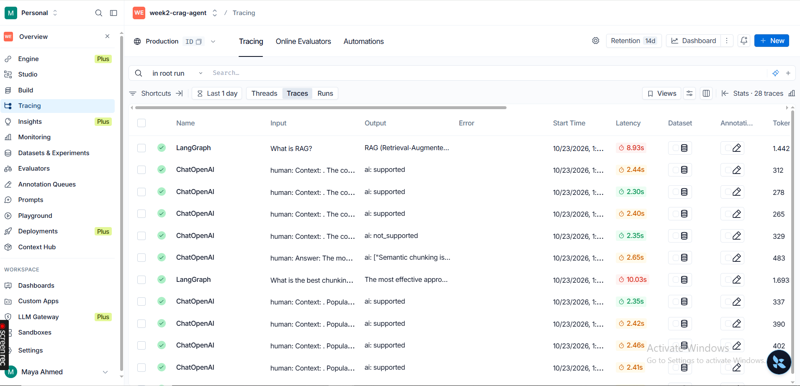

# LangGraph CRAG Agent

Production-style Corrective RAG (CRAG) system built with LangGraph.

## What it does
- CRAG pipeline: retrieve → grade relevance → generate, or fall back to web search (Wikipedia)
- Persistent checkpointing with SQLite
- Human-in-the-loop interrupts
- Streaming FastAPI endpoint (SSE)
- Faithfulness evaluation
- LangSmith tracing

## Stack
LangGraph · LangChain · ChromaDB · Groq · FastAPI · LangSmith

## Results
- Faithfulness score: **0.94**
- Traces visible in the LangSmith dashboard



## How to run
The notebook is designed for Google Colab.

1. Open `CRAG_Production_Project.ipynb` in Colab.
2. Add these secrets in Colab (key icon in the left sidebar):
   - `GROQ_API_KEY`
   - `LANGCHAIN_API_KEY`
3. Run all cells.

To run locally instead:

```bash
pip install -r requirements.txt
cp .env.example .env   # then fill in your keys
```

You will need to replace the `google.colab` `userdata` calls with `os.getenv(...)`.

## Project structure
```
├── CRAG_Production_Project.ipynb
├── README.md
├── requirements.txt
├── .env.example
├── .gitignore
└── assets/
    └── langsmith_trace.png
```